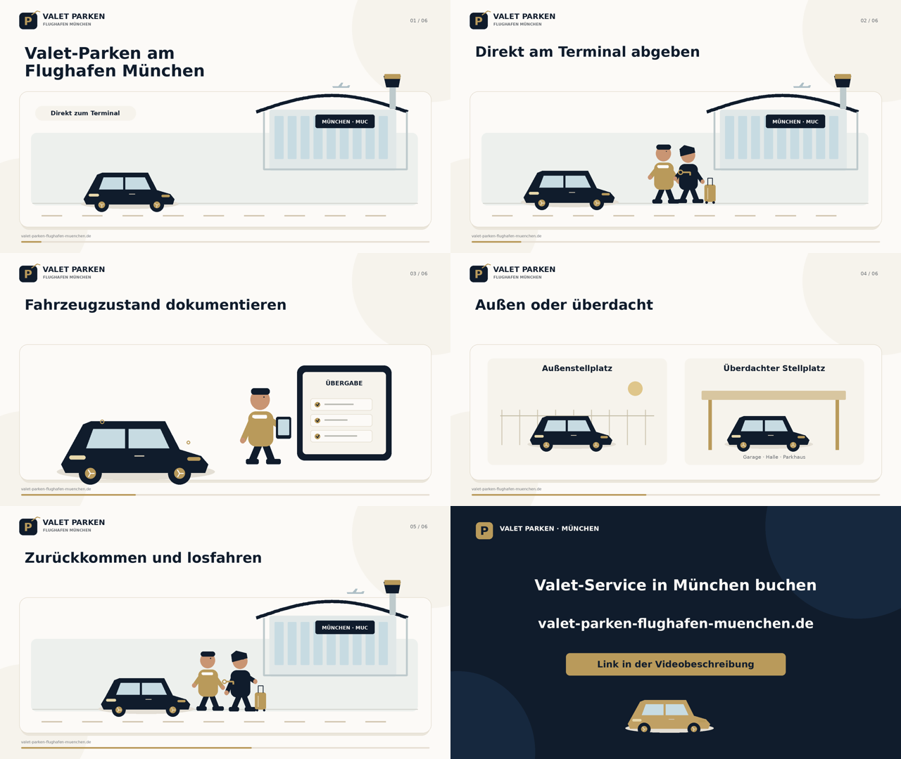

# Vorschau: neue Anbieter und 2D-Erklärvideo

[Webvorschau als ZIP herunterladen](../pakete/vpm-affiliate-webvorschau.zip?raw=true) – vollständig entpacken und **index.html** öffnen. Keine WordPress-Installation nötig.

[Video als MP4](../media/valet-erklaervideo/valet-parken-muenchen-erklaervideo.mp4?raw=true) · [YouTube-Uploadpaket](../pakete/vpm-youtube-upload.zip?raw=true) · [Bearbeitbare Projektdateien](../pakete/vpm-erklaervideo-projekt.zip?raw=true)

Kurzer Animationsausschnitt (ohne Ton):

Sechs Szenen im Überblick:

## Seitenansichten

- [Startseite Desktop](affiliate-video-2026-11/startseite-1440.png) / [Mobil](affiliate-video-2026-11/startseite-390.png)
- [Preise Desktop](affiliate-video-2026-11/preise-1440.png) / [Mobil](affiliate-video-2026-11/preise-390.png)
- [Sicherheit Desktop](affiliate-video-2026-11/valet-parken-sicherheit-1440.png) / [Mobil](affiliate-video-2026-11/valet-parken-sicherheit-390.png)

Live-Seite unverändert. Video noch nicht auf YouTube hochgeladen.
