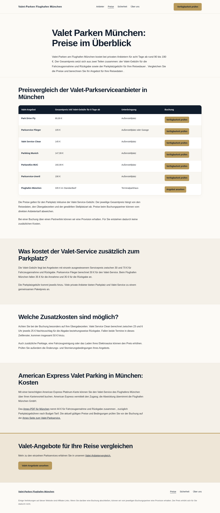
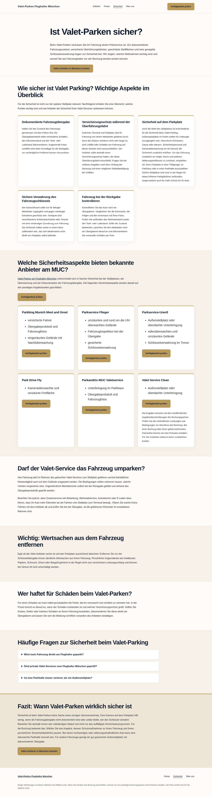
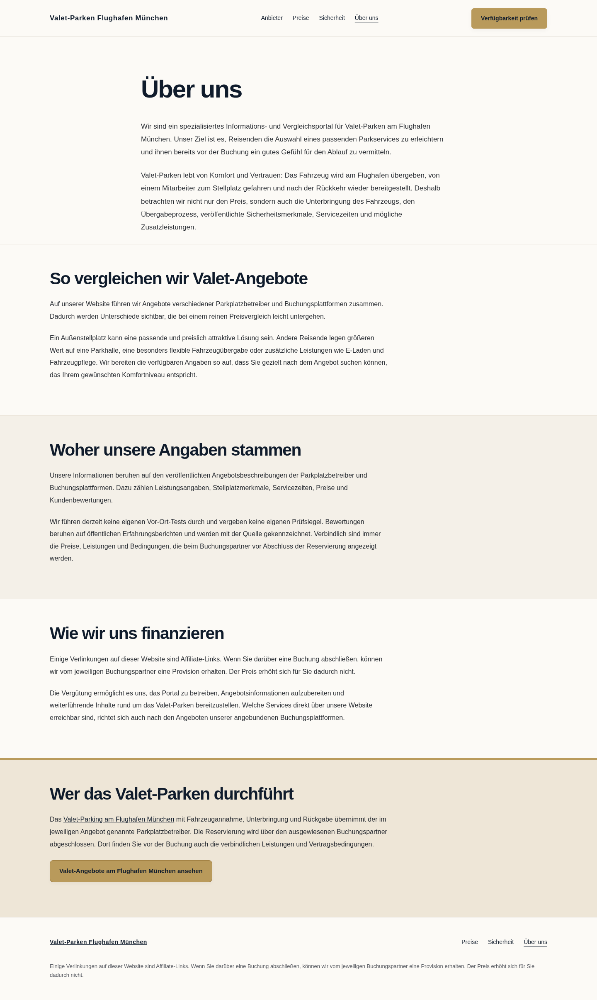

# Aktueller Zwischenstand

Diese Bilder zeigen die tatsächlich gerenderte lokale WordPress-Website. Dafür müssen weder GitHub Pages noch GitHub Actions eingerichtet werden.

## Startseite – erster Bildschirm

## Gestaltete Textabschnitte

## Preistabelle – Mobilansicht

## Startseite – mobil

## Preise

## Sicherheit

## Über uns

## Klickbare Vorschau herunterladen

Öffne [vpm-vorschau.zip](vpm-vorschau.zip) und klicke auf **Download raw file** (Download-Symbol). Entpacke das ZIP vollständig und öffne `index.html` mit deinem Browser. Das ZIP enthält die vier Seiten und alle benötigten Bilder und Styles. Die statische Vorschau wurde über einen lokalen Webserver geprüft; das direkte Öffnen per `file://` ist in der Cloud-Umgebung gesperrt und konnte hier nicht geprüft werden.
