Aktueller Stand Update 0.4.0: [Englische Seiten und neue Anbieterkarten](englisch/README.md). [Installationsanleitung](../docs/UPDATE-0.4.0.md). Die folgenden Screenshots dokumentieren zum Teil frühere Zwischenstände.

# Aktueller Zwischenstand – Design- und Technikprüfung

Die Bilder zeigen die tatsächlich gerenderte lokale WordPress-Website. Texte und Zwischenüberschriften sind unverändert. Der freigegebene Vergleichsbutton führt zur Preisseite; der Preislink steht über den Anbieterkarten. Der mobile Hero nutzt nun die volle Breite; das Tabletmenü ist kompakter. Listen, Kartenraster und Ablauf wurden vereinheitlicht. Bilder sind ausdrücklich gekennzeichnete KI-Symbolbilder; keine tatsächlichen Anbieteraufnahmen. Für die Screenshots sind weder GitHub Pages noch GitHub Actions nötig.

[Prüfbericht mit Ladezeiten und weiteren Empfehlungen](../docs/DESIGN-UND-TECHNIK-AUDIT.md)

## Valet-Ratgeber – privater Entwurf

Die Übersicht bleibt unveröffentlicht und ist nicht im Menü verlinkt. Spätere veröffentlichte Beiträge erscheinen automatisch. Die Screenshots zeigen den leeren Entwurf; keine Testartikel bleiben zurück.

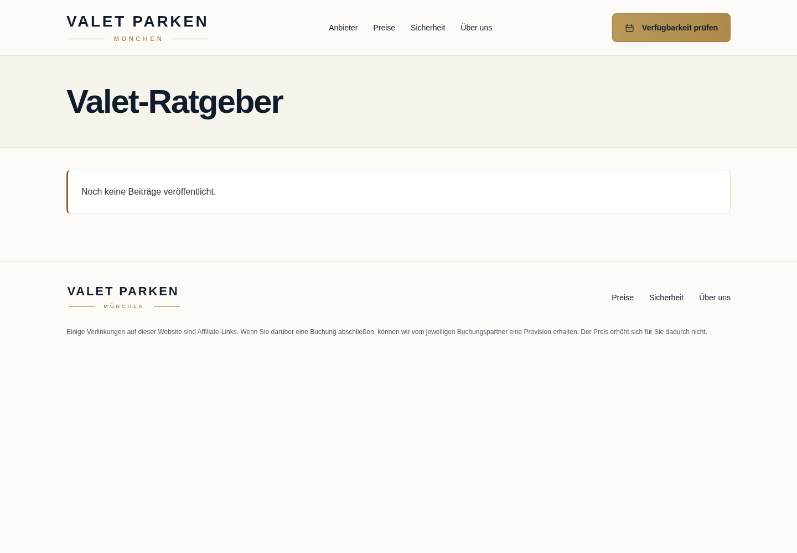

[Entwurf am Handy](ratgeber-entwurf-mobil.png) · [Pflegeanleitung](../docs/RATGEBER.md) · [Rendering, Kontraste und Imagify](../docs/RENDERING-KONTRASTE-IMAGIFY.md)

## Startseite – erster Bildschirm

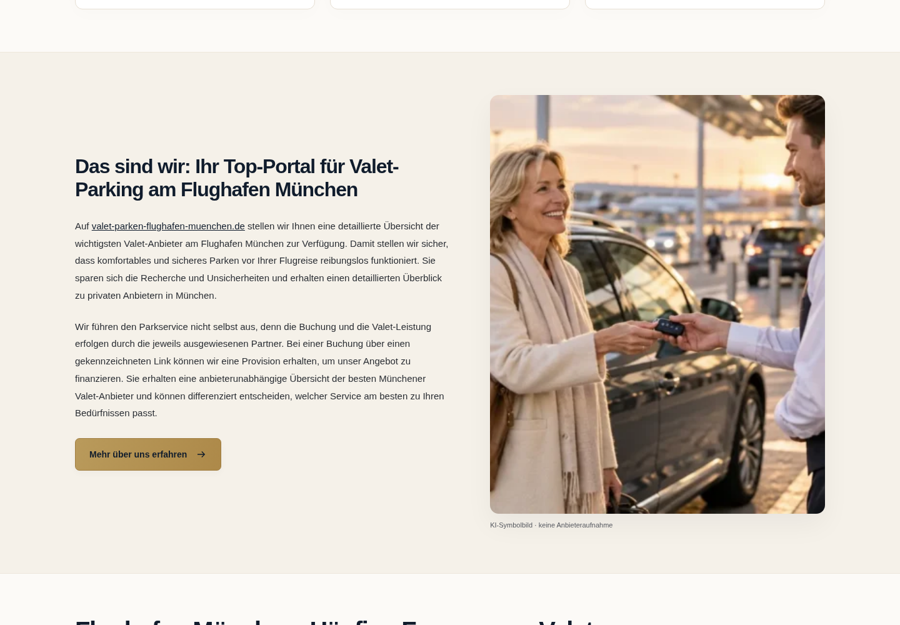

## Anbieterbereich mit Preislink

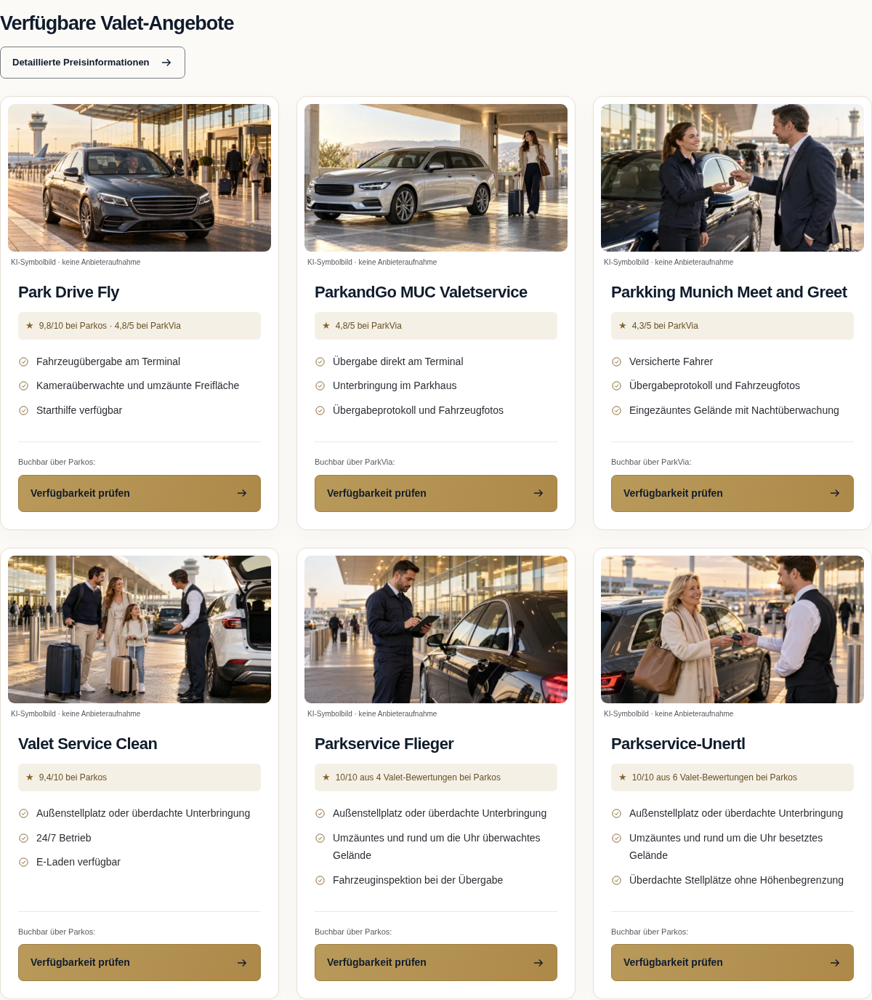

## Sechs Anbieter – unterschiedliche Bilder

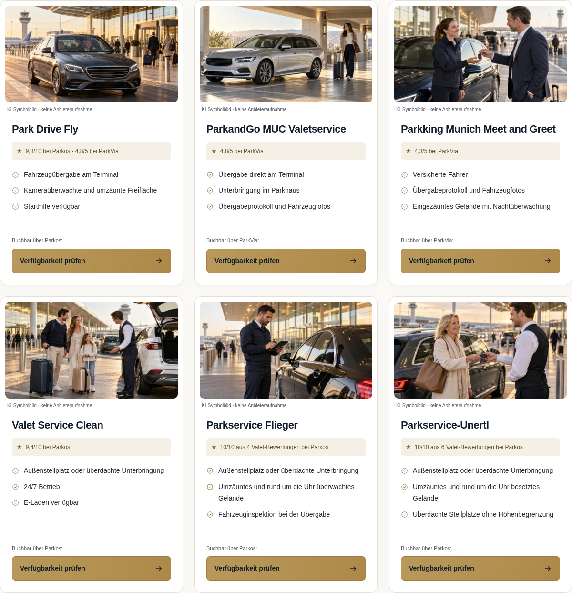

## Startseite – mobiler Einstieg

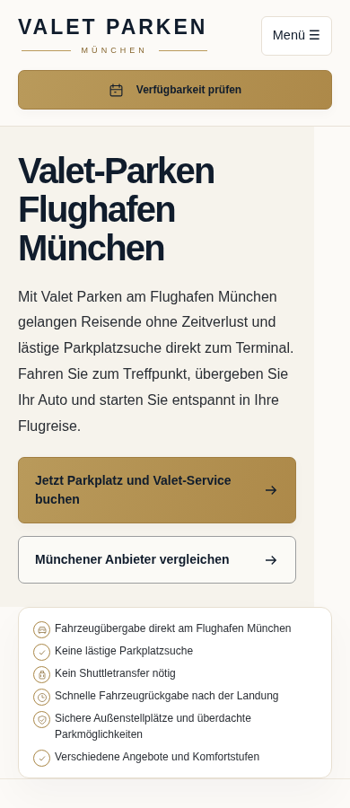

## Ablauf – fünf Schritte mit eigenem Buchungsbutton

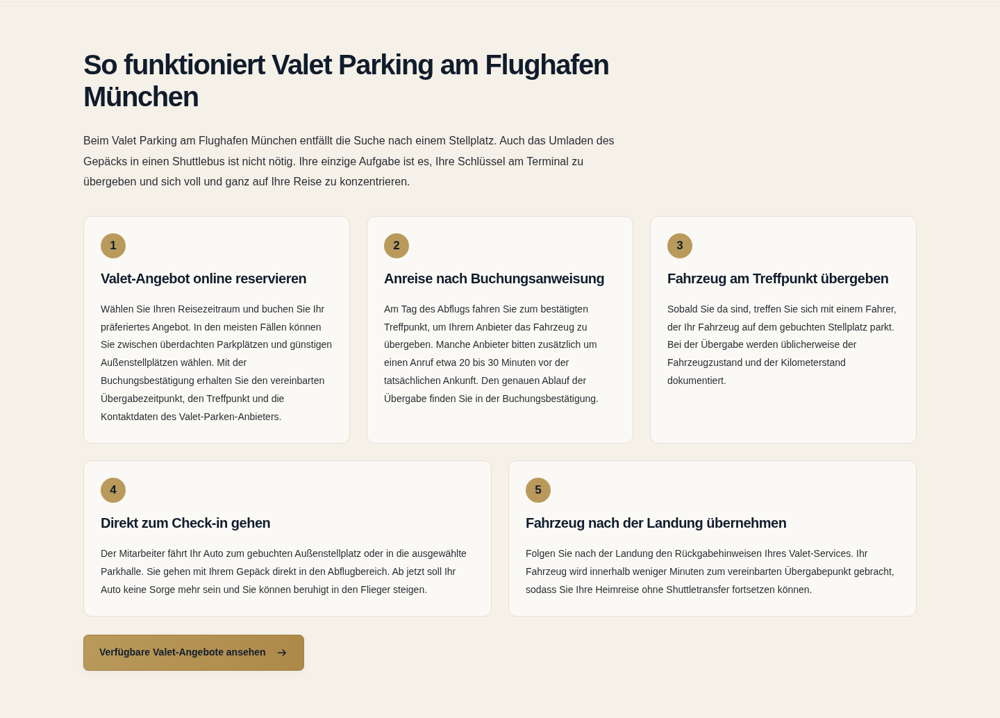

## Sicherheit – einheitliche Karten und Buttons

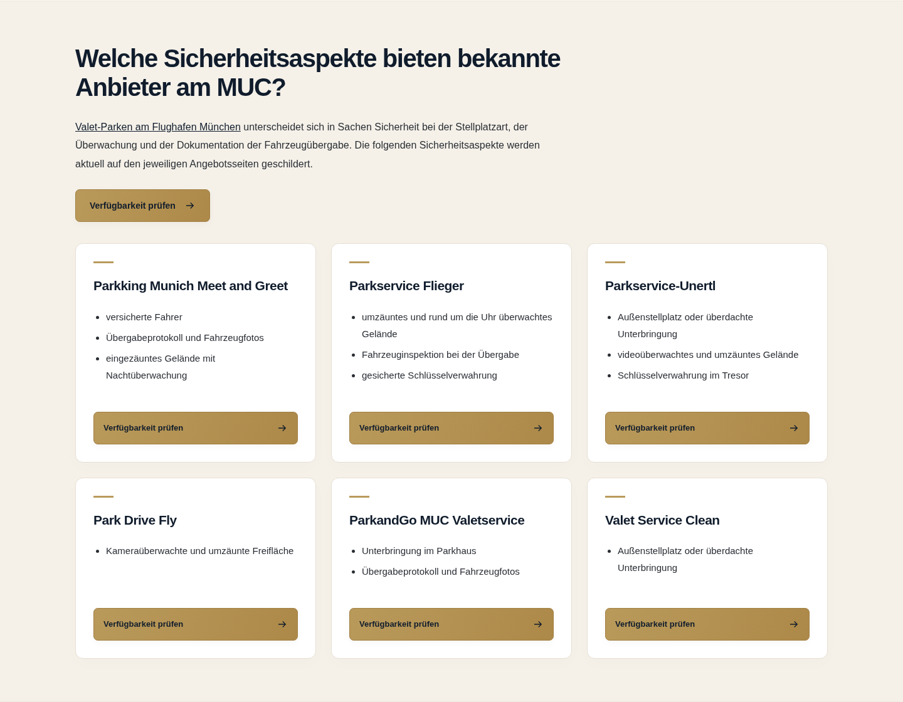

[Dieselben Karten am Handy](sicherheitskarten-mobil.png)

## Tabletmenü

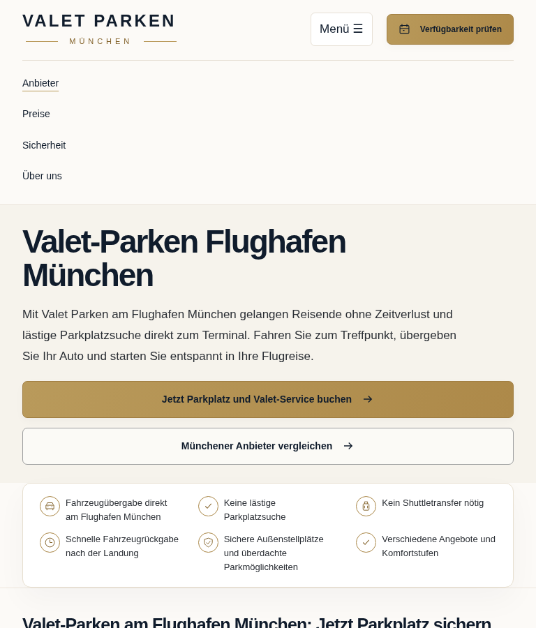

## Bildbereich mit Über-uns-Button

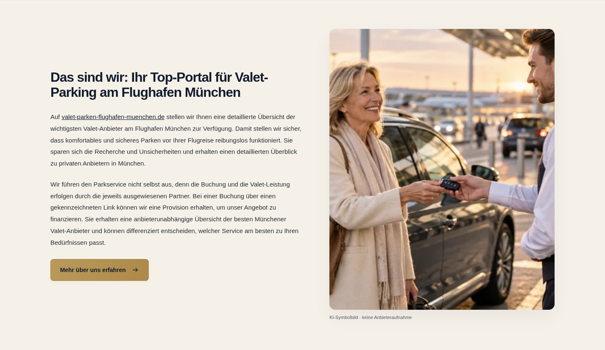

## Preise – Einstieg

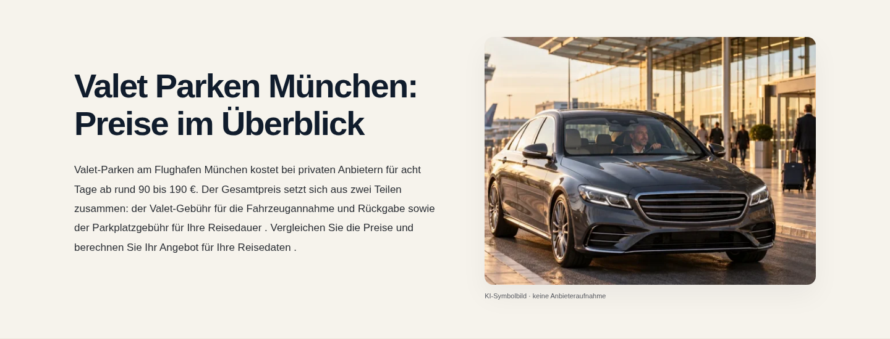

## Sicherheit – Einstieg

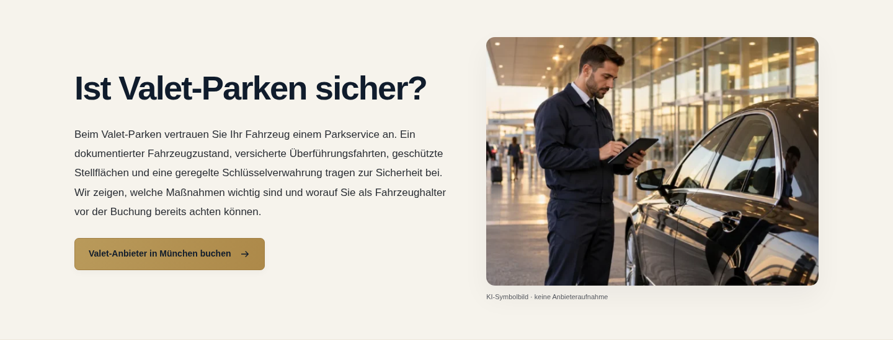

## Über uns – Einstieg

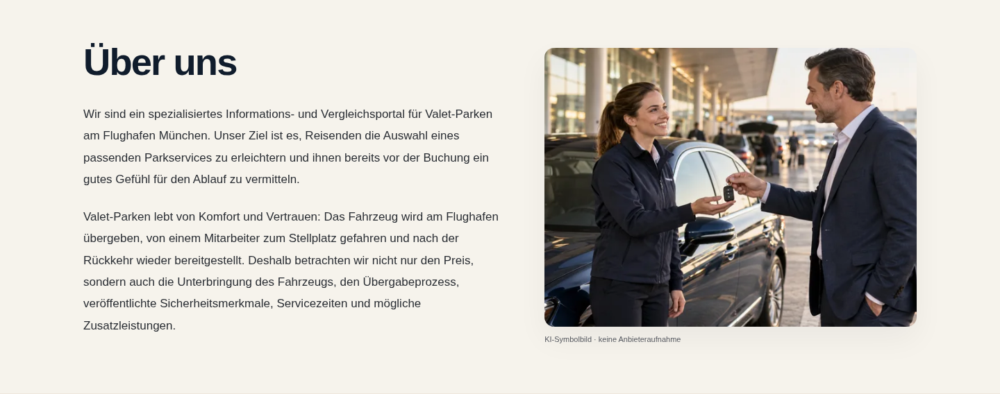

## Umparken – Bild im Abschnitt

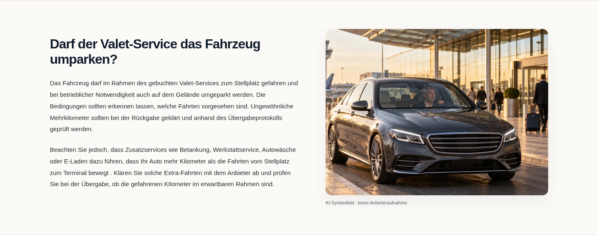

## Wie wir uns finanzieren – Bild im Abschnitt

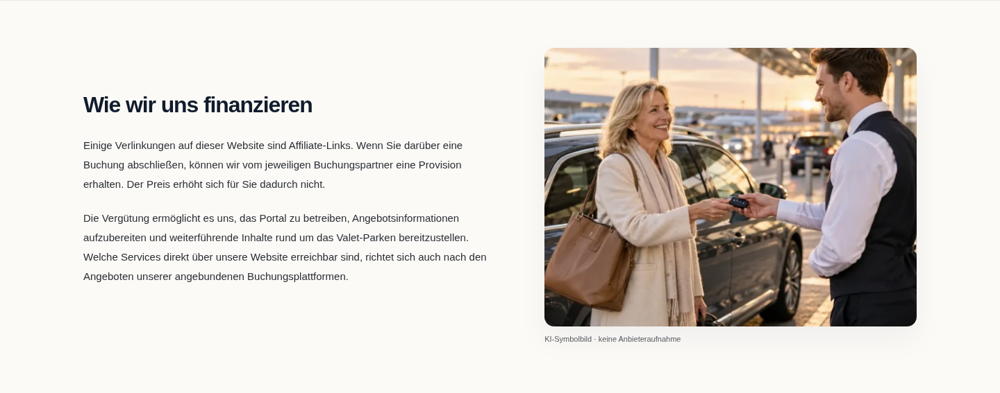

## Preistabelle – gleich breite Buttons

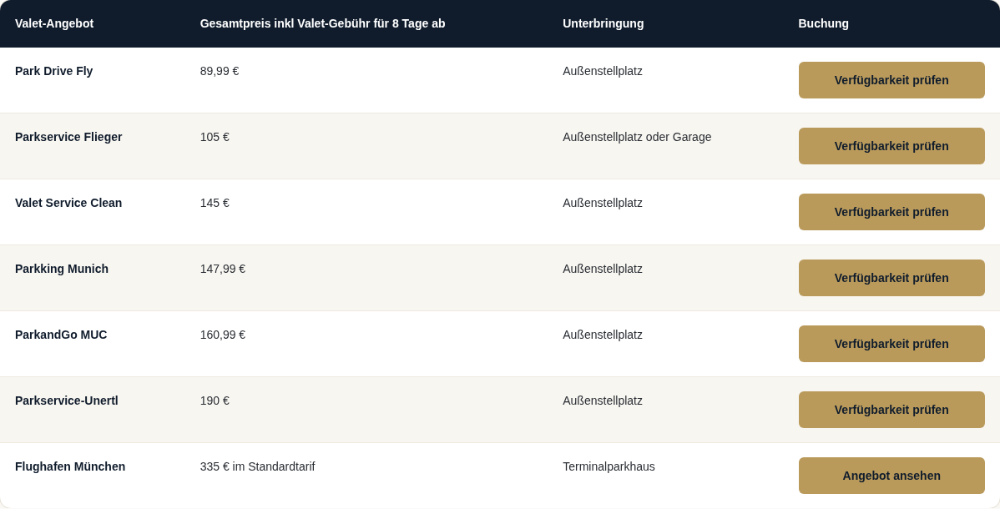

## Preistabelle – Mobilansicht

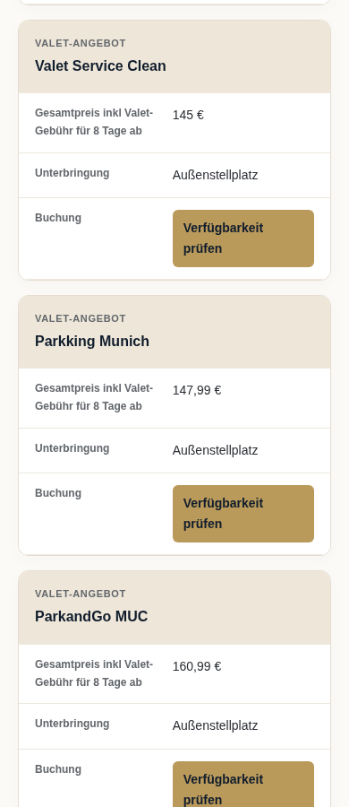

## Ganze Seiten

- [Startseite mobil vollständig](startseite-mobil.png)
- [Preise vollständig](preise.png)
- [Sicherheit vollständig](sicherheit.png)
- [Über uns vollständig](ueber-uns.png)

## Klickbare Vorschau herunterladen

Öffne [vpm-vorschau.zip](vpm-vorschau.zip) und klicke auf **Download raw file** (Download-Symbol). Entpacke das ZIP vollständig und öffne `index.html` mit deinem Browser. Das ZIP enthält die vier Seiten und sämtliche benötigten Bilder und Styles. Die statische Vorschau wurde über einen lokalen Webserver geprüft; das direkte Öffnen per `file://` ist in dieser Cloud-Umgebung gesperrt und konnte hier nicht geprüft werden.
